# Brief projet et PRD — appli DoctoResto (bêta avril 2027)

> Compilé le 2026-11-20 à partir du cerveau Doctoresto (sources du Drive « DOCTO RESTO » importées le même jour).
> Chaque fait renvoie à sa source. **Statut des informations** : ✅ décidé · 🟡 proposé, non voté · ❓ ouvert · 💡 proposition de compilation (à valider par l'équipe).
> **Références (décisions du 2026-11-21, Florian)** : la **discussion du 9/11** ([[2026-11-09-notes-granola-reunion]]) prime sur le process de Lancelot **sur les points où ils se contredisent** (paiement du client, reversement aux techniciens, commande des pièces, 2e passage, stock) ; le **process de Lancelot** ([[2026-11-09-process-operationnel]]) reste la référence pour tout le reste (qualification, dispatch par la plateforme, prix calculé par la plateforme, marge, responsabilités, clôture, SAV) et prime sur le CDC V1. Voir [[decisions]]. Le process ainsi amendé sert d'ossature au PRD (§2.3) ; le CDC V1 décrit les écrans, adaptés aux §2.4-2.5.
> Ce document ne remplace pas le CDC V1 de Jess ([[2026-11-02-cahier-des-charges]]) : il l'agrège avec le process, les indicateurs, les décisions et les contraintes, pour servir de base au chiffrage et au développement.

---

## Partie 1 — Brief projet

### 1.1 En une phrase
Une appli mobile de **dépannage d'urgence pour les professionnels du CHR** (restaurants, boulangeries, hôtels, traiteurs) : le client déclare sa panne en moins de 2 minutes, un technicien qualifié et proche intervient, le forfait (déplacement + 1re heure) est débité à son arrivée ; la plateforme encaisse, reverse au technicien et **garde une marge** (décisions du 2026-11-21). ✅ ([[business]], [[2026-11-02-cahier-des-charges]])

### 1.2 Problème
- Une panne en plein service, c'est du chiffre d'affaires perdu. Les pannes d'équipements critiques arrivent souvent tôt le matin ou le week-end. (CDC V1 ; cadrage)
- Les restaurateurs n'investissent pas dans le préventif : le besoin est **l'urgence, en one shot**. (CR du 9/11)
- Côté techniciens : environ 50 % de leur CA est payé en retard ou jamais (CR du 19/10) ; ils veulent paiement sécurisé avant intervention, plus d'affaires, interventions proches. (CR du 9/11)
- ⚠️ **Besoin pas encore vérifié côté restaurateurs** : aucun entretien documenté au 2026-11-20 (questionnaire prêt). Critère d'arrêt du cadrage : si moins de la moitié des boulangers interrogés citent une panne récente mal gérée, le besoin n'est pas assez fort. → [[validation-terrain]]

### 1.3 Marché et concurrence ([[marche-et-concurrence]], veille [[2026-11-20]])
- Pas de plateforme claire de dépannage d'urgence CHR à la demande en France : l'offre se partage entre SAV des fabricants (Electrolux Professional…), grands mainteneurs (Equans, 80 agences), distributeurs avec SAV (Pacoclean), diagnostic à distance en freelance (ComeUp).
- Logiciels FSM (gestion d'interventions, pas de mise en relation) : Praxedo, Synchroteam, InterFast, Infraspeak ; Jobber, ServiceTitan, Housecall Pro à l'international.
- Plateformes grand public : MesDépanneurs.fr (adossé à un énergéticien depuis le 2026-07-31), Yoojo, AlloVoisins.
- **Test MesDépanneurs.fr (Jessica)** : 90 € affichés pour un petit dépannage, artisan trouvé en ~3 min, SMS depuis le numéro perso du technicien 10 min après (la relation sort de la plateforme), devis par photo, intervention le lendemain, ~30 % de commission. → leçons produit : garder la communication **dans** l'appli, rapidité, prix clair.

### 1.4 Cibles (deux faces) ([[icp]])
| | Demande : client CHR | Offre : technicien |
| --- | --- | --- |
| Qui | Restaurateur, hôtelier, traiteur, boulanger | Technicien de marque (Rational, Unox, MKN, RobotCoupe…) ou artisan (électricien, plombier, maçon, peintre, bricoleur) |
| Statut | Professionnel | Auto-entrepreneur, entreprise ou partenaire. Un salarié ne peut pas facturer seul : c'est son entreprise qui contracte. |
| Attente | Rapidité, prix connu avant déplacement, pas de compte obligatoire en urgence | Paiement sécurisé avant intervention, missions proches, plus d'affaires, pièces bien tarifées |
| Cible bêta | **100 restaurateurs** (Paris) | **30 techniciens** |
| Recrutement | Terrain, Sirha, Google Ads (pistes IA) | Listes de techniciens habilités formés chaque année par les fabricants ; fabricants plus favorables que les installateurs (>50 % des installateurs réticents, 2-3 déjà fans). Notes du 9/11 : d'abord les 10 meilleures entreprises (les plus réfractaires), indépendants pour absorber les nouveaux contrats, sectorisation, « équipe joker » ([[2026-11-09-notes-granola-reunion]]) |

Personas des maquettes v6 : **Marie** (Boulangerie Martin) côté client ; **Karim** (DoctoResto Pro) côté technicien. ([[2026-11-02-maquette-ecrans-v6]])

### 1.5 Objectifs et jalons ([[business]], CR du 9/11, diapos du 2/11)
| Date | Jalon |
| --- | --- |
| 21-25 janv. 2027 | Sirha Lyon : négociation fabricants, **au moins un visuel côté technicien** à montrer |
| Janv.-avril 2027 | Référencer fabricants, pièces, puis techniciens habilités |
| Avant avril 2027 | Création de WRLJ SAS (porte le risque d'incident) |
| **Avril 2027** | **Bêta à Paris** (100 clients visés) — cliff du vesting des associés |
| Avril-déc. 2027 | 500 clients |
| 2028 | Développement national, 5 000 clients fin 2028 |

### 1.6 Modèle économique ([[offer]])
- ✅ **Forfait de diagnostic de 129 € HT = déplacement + 1re heure d'intervention** (heure indivisible) : à la commande, **empreinte CB** (pas de débit), libérée automatiquement si aucun technicien ne prend la course avant un délai (ex. minuit) ; **le forfait est débité à l'arrivée du technicien**. (montant du process conservé, débit à l'arrivée de la discussion du 9/11, [[2026-11-09-notes-granola-reunion]] ; décisions du 2026-11-21 ; remplace le forfait de 110 € avec 45 min du CDC)
- ✅ Au-delà de la 1re heure ou si une pièce est nécessaire : **devis calculé par la plateforme** (heures suivantes au taux horaire + pièce au prix de la base + marge), **un seul prix total** ; **2e paiement débité dès la validation du devis par le client**. Le technicien peut lancer le devis avant de quitter le client.
- ✅ **Revenu = marge** : le prestataire travaille à un **tarif contractuel plateforme** connu d'avance ; le client paie le prix calculé par la plateforme ; la différence reste à la plateforme. Seuil de marge brute de Lancelot : > 25 % (alerte < 15 %). (process ; remplace la commission de 10 % du prévisionnel)
- ✅ **Reversement aux techniciens par relevé mensuel** (bimensuel en cas d'urgence de trésorerie), validé par le technicien ; l'argent reste bloqué sur la plateforme jusqu'à la fin de la prestation (« modèle Vinted »). ([[2026-11-09-notes-granola-reunion]])
- ❓ Montants à fixer : **taux horaire des heures suivantes**, grille des tarifs contractuels, règle de marge (heures, pièces). Le **prévisionnel de Jess est à refaire** sur ce modèle.
- Hors bêta : paiement en 3 fois (gros devis), abonnements.

### 1.7 Équipe et ressources
| Qui | Rôle sur l'appli |
| --- | --- |
| Florian (10 %) | **Responsable développement** ; maquette v6 ; doit chiffrer temps et coût de la bêta |
| Jessica (37,5 %, présidente) | CDC V1 (machines), pannes/pièces, fabricants, prévisionnel |
| Lancelot (37,5 %) | Process opérationnel, indicateurs, questionnaire, CDC artisans |
| Léa (15 %) | Com, nom/INPI, coûts géoloc, pistes de style, premier prototype fait avec Claude |

**Contrainte majeure** : disponibilité de Florian = 3 h/semaine pendant 3 semaines puis ~1 h/jour, **peu disponible en mars et avril 2027**, juste avant la bêta. (CR du 26/10) → le développement doit être quasi terminé fin février 2027. 💡

Budget dev dans le prévisionnel 2027 : **3 500 € (dev mobile et cloud)**. Toute dépense > 5 000 € requiert 3 voix sur 4 (pacte, art. 6). La propriété intellectuelle (code, maquettes, bases) est cédée à la société (art. 1).

---

## Partie 2 — PRD (Product Requirements Document)

### 2.1 Périmètre de la bêta
**Dans la bêta** ✅
- Zone : **tout Paris**. (CR du 26/10)
- Interventions les plus demandées, **3 marques au début**. (CR du 26/10) ❓ Les 3 marques ne sont pas encore choisies ; seul Rational est documenté.
- 6 familles d'équipements (CDC) : four et sauteuse · lave-verre et lave-vaisselle · café · fourneau et friteuse · frigo · robot. Marques listées : Rational, Unox, Hobart, MKN, Convotherm (+ « autre marque » à valider).
- Second parcours simplifié « autre équipement » pour les artisans.
- Apps **iOS et Android**, parcours client et technicien, paiement, notifications, **back-office** (validation EXPERT, suivi, litiges). (CDC, MVP)
- Facture automatique par mail. (CDC)

**Hors bêta** ✅
- Suivi du technicien en temps réel (coût API Google) — mais le technicien doit être **dans le périmètre** géographique. (CR du 9/11)
- Machines connectées (codes d'erreur), paiement en 3 fois, abonnements (phase 2 du CDC).
- Affectation **entièrement automatique** (en bêta : la plateforme choisit, avec un outil d'aide), diagnostic par IA, GPS intégré (Waze suffit). (cadrage)
- **Stock du prestataire, commande de pièces et planning des 2es passages par la plateforme** : hors bêta. Le technicien déclare seulement si la pièce est dans son camion ou à commander par son bureau, qui intègre la pose dans sa tournée ; la plateforme garde la visibilité (délai prévu, relances). ([[2026-11-09-notes-granola-reunion]], décision du 2026-11-21 ; remplace la réservation de stock du process)

**Écarts à trancher** ❓
- Cadrage (13/10) : cible boulangerie (four, pétrin, diviseuse, froid ; marques Bongard, Pavailler, Panimatic, VMI) et **mode hors-ligne** (labos mal couverts). Le CDC (2/11) a élargi à la cuisine pro et ne mentionne plus le hors-ligne.
- Cadrage / ODJ du 26/10 (point 14) : **déclarer une panne sans créer de compte**. Le CDC place une étape de connexion avant la déclaration.

### 2.2 Rôles
| Rôle | Description |
| --- | --- |
| Client | Professionnel CHR qui déclare une panne et paie |
| Technicien de marque | Habilité sur une ou plusieurs marques |
| Artisan | Électricien, plombier, maçon, peintre, bricoleur |
| EXPERT DoctoResto (back-office) | Valide les candidatures techniciens, suit les missions, traite les litiges |
| 💡 Admin | Gère catalogues (familles, marques, pannes, pièces, prix), tarifs, paramètres |

### 2.3 Process opérationnel de référence — ossature du produit
Sources : process de Lancelot ([[2026-11-09-process-operationnel]], transcription et analyse dans la fiche) **amendé par la discussion du 9/11** ([[2026-11-09-notes-granola-reunion]]) sur le paiement, le reversement, les pièces et le 2e passage (décision du 2026-11-21). Principe inchangé : **la plateforme porte la relation commerciale, le prestataire la responsabilité technique.** Chaque case devient un écran, une action back-office, un statut ou une règle.

**Flux (réécrit en Mermaid pour le dev)**

```mermaid
flowchart TD
  A[1 Signalement<br/>restaurant : équipement, marque, modèle, plaque, symptômes, photos, urgence] --> B[Qualification<br/>plateforme : pré-diagnostic, urgence, métier, compétence]
  B --> C{2 Engagement<br/>restaurant accepte le forfait 129 € HT<br/>déplacement + 1re heure, dû à l'arrivée}
  C -->|oui| D[Empreinte CB, pas de débit]
  D --> E[3 Dispatch<br/>plateforme : zone × dispo × métier × marque × historique<br/>sectorisation, clients préférentiels]
  E --> F{Prestataire accepte<br/>tarif contractuel connu}
  F -.->|personne avant le délai, ex. minuit| X1[Empreinte libérée]
  F -->|oui| G[Arrivée horodatée<br/>forfait débité]
  G --> H[4 Diagnostic<br/>responsabilité du prestataire : panne, référence, quantité, temps de pose]
  H --> I{Réparé dans la 1re heure ?}
  I -->|oui| S
  I -->|non : heures en plus ou pièce| J[Prestataire déclare : pièce dans le camion ou à commander par son bureau<br/>lance le devis sur place]
  J --> L[5 Plateforme calcule le prix client<br/>heures suivantes + pièce + marge, un seul total<br/>prestataire valide la référence]
  L --> M{Restaurant valide le devis ?}
  M -->|oui| N[2e paiement débité]
  N --> O{Pièce dans le camion ?}
  O -->|oui| R[Pose immédiate, essais, remise en service]
  O -->|non| Q[Bureau du prestataire commande et planifie la pose dans sa tournée<br/>hors plateforme, visibilité : délai fabricant + 1 j, relances J+24 h, J+48 h]
  Q --> R
  R --> S[6 Clôture<br/>photo obligatoire + validation du client dans l'appli<br/>rapport, facture, historique machine]
  S --> T[7 Relevé mensuel validé par le prestataire<br/>plateforme reverse, garde la marge<br/>pièce non payée si délai dépassé]
  T --> U[SAV<br/>plateforme orchestre ; prestataire reprend à ses frais si erreur]
  M -.->|non : remise en état, CDC| X2((à préciser))
```

**Statuts d'une intervention (💡 déduits)**
`signalée` → `qualifiée` → `empreinte posée` → `proposée au prestataire` → `acceptée` (ou `expirée, empreinte libérée`) → `prestataire sur place` (horodaté, **forfait débité**) → `diagnostiquée` → soit `réparée dans l'heure`, soit `devis envoyé` → `devis accepté` (**2e paiement débité**) ou `devis refusé` (remise en état) → `pose immédiate` ou `pièce commandée par le bureau` (délai prévu, relances, `en retard`) → `2e passage` → `réparée` → `remise en service validée` (photo + client) → `au relevé` → `relevé validé par le prestataire` → `prestataire payé` → `close` ; branche `réclamation SAV` après clôture.

**Qui fait quoi, et ce que ça demande à l'appli**
| Étape | Restaurant (appli client) | Plateforme (back-office) | Prestataire (appli pro) |
| --- | --- | --- | --- |
| 1 Signalement | Formulaire : équipement, marque, **modèle, plaque (photo)**, symptômes, photos, urgence | File des demandes ; pré-diagnostic, métier et compétence (manuel en bêta) | — |
| 2 Engagement | Accepte le forfait de 129 € HT (déplacement + 1re heure, dû à l'arrivée) ; **empreinte CB** | Pose l'empreinte ; la libère si personne ne prend la course avant le délai | — |
| 3 Dispatch | — | Choix du prestataire (zone, dispo, métier, marque, historique, **sectorisation, clients préférentiels**) ; manuel assisté en bêta ; équipe joker si défaillance | Reçoit la mission avec le **tarif contractuel**, accepte |
| 4 Arrivée et diagnostic | Accueille le technicien | Horodatage de l'arrivée ; **débit du forfait** | Diagnostic ; saisit panne, **référence, quantité, temps de pose** |
| Réparé dans l'heure | — | — | Répare, passe à la clôture |
| 5 Devis | Reçoit **un seul prix total**, valide ; **2e paiement débité** | Calcule le prix (heures + pièce + marge) | Déclare pièce **dans le camion** ou **à commander par son bureau** ; valide la référence (erreur à sa charge) ; **lance le devis avant de partir** |
| Pièce à commander | Reçoit le délai prévu | **Visibilité seulement** : délai fabricant + 1 j, relances automatiques (J+24 h, J+48 h…) | Son bureau commande et intègre la pose dans sa tournée (hors plateforme) |
| 6 Clôture | **Valide la remise en service** dans l'appli | Rapport, facture, **historique machine** | **Photo obligatoire**, PV (pièce posée, tests, temps passé) |
| 7 Reversement | — | Relevé mensuel (bimensuel si urgence) ; reverse, garde la marge ; **pièce non payée si délai dépassé** | Valide son relevé, signale les erreurs |
| SAV | Réclame auprès de la plateforme, son seul interlocuteur | Orchestre ; pas de nouvelle facture si erreur du prestataire | Reprend à ses frais (diagnostic, référence, malfaçon) |

**Conséquences pour le périmètre de la bêta** 💡
- Le **back-office reste central** (qualification, dispatch, calcul de prix, suivi des délais de pièces, relevés, SAV), mais **sans commande de pièces, sans stock et sans planning** : périmètre nettement réduit (décision du 2026-11-21).
- **Référentiels avant le lancement** : taux horaire des heures suivantes, grille de tarifs contractuels des prestataires, **base de pièces avec prix publics et délais fabricant**, règle de marge. Base existante : Rational ([[2026-11-01-pannes-rational]]).
- **Paiement** : empreinte CB à la commande (courte, même jour), débit du forfait (129 € HT) à l'arrivée, 2e paiement à la validation du devis, client présent dans l'appli ; reversement mensuel. Mécanique Stripe : [[stack-technique]].

### 2.4 Parcours client — 14 écrans (CDC V1)
| # | Écran | Exigences |
| --- | --- | --- |
| C1 | Accueil | 2 boutons : « J'ai une panne » / « Je suis un technicien » |
| C2 | Connexion | Identifiants, Face ID, Apple, Google, saisie manuelle. ❓ Parcours sans compte en urgence |
| C3 | Type | Machine en panne ou autre équipement (parcours artisan simplifié) |
| C4 | Famille | 6 familles d'équipements |
| C5 | Marque | Rational, Unox, Hobart, MKN, Convotherm ; « autre marque » à valider |
| C6 | Connectée ? | Machine connectée ou non (info seulement en bêta) |
| C7 | Description | Texte + photo. 💡 Ajouter modèle et photo de la plaque signalétique (process étape 1) |
| C8 | Récapitulatif et géolocalisation | Consentement RGPD |
| C9 | Conditions | **Forfait de diagnostic de 129 € HT (déplacement + 1re heure d'intervention), débité à l'arrivée du technicien** ; au-delà ou avec pièce, devis calculé par la plateforme, payé à sa validation *(décision du 2026-11-21 ; le CDC disait 110 € avec 45 min)* |
| C10 | Paiement | **Empreinte CB** (pas de débit), libérée si aucun technicien avant le délai ; carte enregistrée ; CB, Apple Pay, 3-D Secure ; (3 fois : hors bêta). Cible : panne → commande **< 2 min** |
| C11 | Prestataire et heure d'arrivée | Prestataire choisi par la plateforme ; heure confirmée par lui (pas de suivi en direct en bêta) |
| C12 | Devis | Devis calculé par la plateforme (heures en plus et/ou pièce), **un seul total**, accepter (**2e paiement débité**) ou refuser (remise en état initial, CDC) ; si pièce à commander, délai prévu |
| C13 | Remise en service | Le restaurant **valide la remise en service** (sinon : réclamation) ; rapport et facture |
| C14 | Notation | Ponctualité, professionnalisme, explications, appli, recommandation |

Écrans complémentaires vus dans la maquette v6 : historique des interventions, factures, compte. ([[2026-11-02-maquette-ecrans-v6]])

### 2.5 Parcours technicien — 11 écrans (CDC V1)
| # | Écran | Exigences |
| --- | --- | --- |
| T1 | Accueil | — |
| T2 | Connexion et géolocalisation | — |
| T3 | Profil | Artisan (métier) ou technicien de marque (marques) |
| T4 | Candidature | Validée par un EXPERT en back-office. Pièces à exiger (piste IA) : Kbis, attestation URSSAF, RC pro et décennale, habilitations (électrique, fluides frigorigènes). 💡 + données DAC7 (identité, SIREN, IBAN) |
| T5 | Mission proposée | Proposée par la plateforme (meilleur prestataire), avec le **tarif contractuel** ; accepter et fixer son heure ; refus → la plateforme propose au suivant |
| T6 | Détail de la panne | Infos et photos du client |
| T7 | Arrivée | Validée par géolocalisation ; **horodatage de l'arrivée = débit du forfait** *(plus de compteur de 45 min)* |
| T8 | Diagnostic | Panne, **référence, quantité, temps de pose** ; réparé dans l'heure, heures en plus, pièce nécessaire ; réparation impossible |
| T9 | Devis | Le prestataire indique si la pièce est **dans son camion** ou **à commander par son bureau** et **lance le devis avant de quitter le client** ; **la plateforme calcule le prix client** ; le prestataire **valide la référence** (erreur à sa charge) |
| T10 | Réponse client et 2e passage | Refus = remise en état initial ; accord → pose immédiate si pièce dans le camion, sinon son bureau commande et planifie la pose (hors plateforme) ; délai fabricant + 1 j, relances |
| T11 | Clôture et relevé | **Photo obligatoire**, PV (pièce posée, tests, temps passé) ; **relevé mensuel à valider** avant paiement |

Maquette v6 côté technicien : statut disponible / hors ligne, missions à moins de 20 km, planning, revenus. Photo de la pièce obligatoire au diagnostic.

### 2.6 Back-office (CDC : validation EXPERT, suivi, litiges ; process : §2.3)
Fonctions issues du CDC et du process de Lancelot :
1. **Candidatures prestataires** : validation EXPERT, pièces justificatives, métiers, marques habilitées, zone, **tarif contractuel**.
2. **File des demandes et qualification** : pré-diagnostic, urgence, métier, compétence.
3. **Dispatch** : liste des prestataires filtrée (zone, disponibilité, métier, marque) et triée (historique) ; envoi de la mission ; relance si refus ou absence de réponse.
4. **Suivi en direct des missions** par statut (§2.3), avec horodatages.
5. **Calcul de prix** : heures au-delà de la 1re au taux horaire + pièce au prix de la base + marge ; un seul total affiché au client.
6. **Pièces** : base par marque avec prix publics, délais fabricant, poids ; **pas de commande ni de stock** (le bureau du prestataire commande).
7. **Suivi des délais de pièces** : délai fabricant + 1 j, relances automatiques, retard signalé (pièce non payée au prestataire).
8. **Clôture** : contrôle du PV et des photos, rapport, facture, historique machine.
9. **Paiements** : empreintes, débits (1re heure, devis), **relevés mensuels** validés par les prestataires, reversements, marge ; export comptable ; données DAC7.
10. **SAV et litiges** : réclamations, imputation au prestataire (reprise à ses frais), suivi.
11. **Indicateurs** (§2.10) et catalogues (familles, marques, pannes, pièces).

### 2.7 Règles métier
| Règle | Statut |
| --- | --- |
| Empreinte CB à la commande, sans débit ; libérée automatiquement si aucun technicien ne prend la course avant un délai (ex. minuit) | ✅ 9/11 (décision du 2026-11-21) |
| **Forfait de diagnostic de 129 € HT = déplacement + 1re heure d'intervention** (indivisible), **débité à l'arrivée du technicien** (arrivée horodatée) ; heures suivantes au taux horaire | ✅ process (montant) + 9/11 (débit à l'arrivée) ; décisions du 2026-11-21 |
| Heures suivantes et pièce : devis calculé par la plateforme, **un seul prix total** ; **2e paiement débité à la validation du devis** | ✅ 9/11 + process |
| Le technicien peut lancer le devis avant de quitter le client | ✅ décision du 2026-11-21 |
| Refus du devis : machine remise en l'état initial | ✅ CDC |
| La plateforme choisit le prestataire (zone × dispo × métier × marque × historique) ; refus → proposé au suivant | ✅ process + CDC |
| **Sectorisation** : un client reste au même technicien ; clients préférentiels pris en compte dans le dispatch | ✅ 9/11 + indicateurs de Lancelot |
| Équipe joker quand un technicien fait défaut | 🟡 9/11 |
| Le technicien doit être dans le périmètre (pas de suivi en direct) | ✅ CR 9/11 |
| Paiement en 3 fois : gros devis seulement, hors bêta | ✅ |
| Responsabilité commerciale = plateforme ; technique = prestataire | ✅ process |
| Revenu = marge ; prestataire payé à son tarif contractuel | ✅ process ; montants ❓ |
| Le prestataire engage sa responsabilité sur son diagnostic et sur la référence de pièce | ✅ process |
| **Pièce commandée par le bureau du prestataire**, pose intégrée à sa tournée ; 2e passage hors plateforme, visibilité maintenue | ✅ 9/11 (décision du 2026-11-21) |
| Délai fabricant + 1 jour de tolérance, relances automatiques (J+24 h, J+48 h…) ; **délai dépassé : pièce non payée au prestataire** | ✅ 9/11 |
| Clôture : photo obligatoire + validation du restaurant dans l'appli | ✅ 9/11 + process |
| **Reversement par relevé mensuel** (bimensuel si urgence), validé par le prestataire | ✅ 9/11 (décision du 2026-11-21) |
| SAV : pas de nouvelle facture si erreur du prestataire, reprise à sa charge | ✅ process |
| Client en cas de retard de pièce (remboursement, geste) | ❓ |
| Si aucun technicien : empreinte libérée ; délai maximum | 🟡 / ❓ |
| Panne non réparable : forfait dû ? | ❓ |
| Machine non listée / « autre marque » | ❓ |
| Astreinte payée ou non (5 h du matin, dimanche) | ❓ cadrage |
| Durée de la garantie | ❓ |

### 2.8 Cas limites à prévoir ([[2026-11-09-indicateurs-suivi]])
45 min de circulation · parking impossible · technicien mobilisé 1 h 45 · modèle non identifié · appareil inaccessible · client incapable d'expliquer la panne · référence illisible · panne intermittente · machine à remplacer · peur de la concurrence entre prestataires · aucun technicien disponible · panne non réparable · litige.

### 2.9 Exigences non fonctionnelles
- **Plateformes** : iOS et Android (CDC). Publication App Store et Play Store (coûts listés au prévisionnel).
- **Performance d'usage** : de la panne à la commande en moins de 2 minutes (CDC).
- **Réseau** : labos et cuisines souvent mal couverts → mode dégradé / hors-ligne au moins côté technicien. ❓ (cadrage, absent du CDC)
- **Paiement** : CB, Apple Pay, 3-D Secure ; pré-autorisation ou encaissement du forfait (process) ; reversement aux techniciens → **marketplace avec paiements fractionnés** (piste : Stripe Connect). Frais Stripe estimés à ~3,85 € par intervention de 240 € (doc IA, à vérifier).
- **Conformité** :
  - **RGPD** : géolocalisation et photos (consentement, durée de conservation ❓).
  - **DAC7** : déclaration annuelle à la DGFiP des revenus versés aux techniciens ; KYC et diligences sur les vendeurs (veille du 2026-11-20).
  - CGU plateforme, statut et RC pro des artisans, habilitations électriques et fluides frigorigènes.
  - Facturation automatique conforme.
- **Coûts d'exploitation** : 0,20 à 1 € par utilisateur et par mois (estimation de Florian, 13/10). Temps réel Firebase/Supabase : 0-25 €/mois au début. Google Routes/géocodage : 10 000 appels gratuits/mois puis 5 $ les 1 000 ; à 500 interventions/mois, un recalcul toutes les 2 min reste gratuit, toutes les 30 s ≈ 50 $ ([[2026-11-09-cout-geolocalisation]]).
- **Propriété intellectuelle** : code et maquettes cédés à WRLJ (pacte, art. 1) ; e-Soleau (CDC, maquettes, concept) avant le Sirha.

### 2.10 Indicateurs produit ([[2026-11-09-indicateurs-suivi]], CDC)
| Indicateur | Continuer | Alerte |
| --- | --- | --- |
| Acceptation des devis | > 70 % | < 50 % |
| Prestataire trouvé | > 95 % | < 85 % |
| Intervention urgente en < 4 h | > 80 % | < 60 % |
| Résolution au premier passage | > 65 % | < 45 % |
| Litiges | < 5 % | > 10 % |
| Marge brute par intervention | > 25 % | < 15 % |
| Restaurants qui réutilisent le service | > 40 % | < 20 % |
| Erreur de diagnostic ou de référence | < 5 % | > 10 % |
CDC : délai d'arrivée, réparation au premier passage, note moyenne. Doc IA : note > 4,7, coût d'acquisition < 25 €. Fréquence visée : 1,5 intervention par mois et par client (2027).
💡 Chaque indicateur implique un événement à tracer dans les données (horodatages de demande, acceptation, arrivée, clôture ; issue ; litige ; prix pièce et marge).

### 2.11 Modèle de données (ébauche 💡)
- **Utilisateur** (client | technicien | expert | admin), auth (Apple, Google, Face ID, email).
- **Établissement client** : nom, type CHR, adresse/coordonnées, contacts.
- **Technicien** : statut (artisan | marque), métiers, marques habilitées, zone, disponibilité, documents (Kbis, URSSAF, RC pro, décennale, habilitations), données DAC7 (identité, SIREN, IBAN), statut de validation, note.
- **Équipement** : famille, marque, modèle, plaque, connecté (oui/non), historique d'interventions.
- **Catalogue** : familles → marques → pannes fréquentes (codes erreur) → pièces (référence, prix moyen HT, poids). Données initiales : [[2026-11-01-pannes-rational]] (fours mixtes : 9 pièces, de 12 € à 810 € HT ; sauteuses iVario : 12 pièces).
- **Intervention** : demande (symptômes, photos, urgence, modèle, plaque), qualification (métier, compétence), statut (§2.3), prestataire, heures (demande, acceptation, arrivée prévue, arrivée réelle, début du diagnostic, fin), diagnostic (panne, référence, quantité, temps de pose), issue, rapport.
- **Passage** : une intervention peut avoir plusieurs passages (diagnostic, pose) ; date prévue (pose : fixée par le bureau du prestataire), horodatages, PV (pièce posée, tests, temps passé, photo obligatoire).
- **Tarif contractuel prestataire** : part du forfait, taux horaire, consommables.
- **Pièce à poser** (par intervention) : référence, source (camion / commande par le bureau), délai fabricant, date de pose prévue, relances, retard (pièce non payée).
- **Relevé prestataire** (mensuel ou bimensuel) : interventions, montants, statut (envoyé, contesté, validé, payé), transferts associés.
- **Réclamation SAV** : intervention liée, motif (diagnostic, référence, malfaçon), imputation, résolution.
- **Devis** : lignes internes (heures, consommable, pièce, marge) et **un seul total affiché au client**, statut, accord horodaté, 2e paiement associé.
- **Paiement** : empreinte (posée, capturée pour le forfait, libérée), débit du devis.
- **Paiement / reversement / facture**, **litige**, **notation** (5 critères).

### 2.12 Options techniques et chiffrage (à produire par Florian)
> **Première piste retenue le 2026-11-21 : Expo + Convex (ou Supabase) + Stripe**, détail, MVP d'un mois et estimation (~90-100 h pour le périmètre complet) dans [[stack-technique]]. Le tableau ci-dessous reste pour l'historique.

Pistes du doc IA de la feuille de route (non relu par l'équipe, [[2026-11-15-feuille-de-route-ia]]) :
| Option | Délai | Coût |
| --- | --- | --- |
| No-code : Bubble ou Sharetribe + Stripe Connect (recommandé par le doc) | 3 à 6 semaines | 0 à 3 500 € |
| Sur mesure : React/Node | 3 à 6 mois | 15 000 à 35 000 € (prestataire) |
Autres repères : géoloc en direct en freelance 1 500 à 5 000 € (hors bêta) ; budget de lancement 6 mois 5 000 à 9 000 € (doc IA) ; dev mobile et cloud 3 500 € au prévisionnel 2027.
💡 Critères de choix à documenter dans le chiffrage : apps natives iOS/Android exigées par le CDC (Sharetribe est surtout web), hors-ligne, Stripe Connect et KYC/DAC7, back-office, réversibilité du code (cédé à la société), dev assisté par IA (Léa a déjà un prototype Claude), disponibilité réduite de Florian en mars-avril 2027, coûts récurrents.
Actions liées : envoyer ses estimations de coûts à Jess (prévisionnel) ; relever les heures de dev (valorisation au bilan, apport de Florian en partie en travail).

### 2.13 Identité visuelle
- 6 pistes de style ([[2026-11-02-pistes-style]]) ; **le bleu plaît à la majorité** (CR du 9/11), probablement la piste F « Gyrophare » : bleu nuit #0A1F44, ambre #FFB000, acier ; Plus Jakarta Sans ; « urgence maîtrisée, confiance ».
- Contrainte : **éviter le bleu cyan et toute typo proche de Doctolib** (risque de parasitisme). L'orange/beige de la première maquette de Léa fait « appli générée par IA ».
- Maquette v6 (Florian) : design system forêt, orange, lime, blé ; thèmes clair et sombre — antérieure au choix du bleu.
- Nom : plutôt **DoctoResto** pour l'appli, pas définitif ; société WRLJ. Vérifier domaine et @doctoresto. ([[2026-11-09-recap-nom-inpi]])

### 2.14 Planning de développement (💡 proposition à valider)
| Période | Livrable |
| --- | --- |
| Fin nov. 2026 | Chiffrage temps/coût + choix no-code ou sur mesure ; réponses aux questions ouvertes du CDC |
| Déc. 2026 | Visuels côté technicien (pour le Sirha) ; choix de la piste graphique ; e-Soleau |
| Janv. 2027 | Sirha (21-25/01) : démo côté technicien ; catalogue pièces/marques complété avec les fabricants |
| Janv.-fév. 2027 | Développement MVP, back-office, paiement, onboarding techniciens |
| Mars 2027 | Tests avec quelques techniciens et restaurateurs (Florian peu disponible : prévoir le relais) |
| Avril 2027 | Bêta Paris |

---

## Partie 3 — Incohérences et questions ouvertes

### 3.1 Incohérences entre sources
| Sujet | Valeurs | Sources |
| --- | --- | --- |
| Forfait | 80 € (déplacement + 1re heure) · 110 € (45 min) · **129 € HT, forfait de diagnostic = déplacement + 1re heure d'intervention, débité à l'arrivée (retenu le 2026-11-21)** ; heures suivantes au taux horaire (à fixer) · panier 240 € | maquette v6 · CDC + CR 9/11 · process · notes du 9/11 · doc IA |
| Paiement et pièces | 9/11 ([[2026-11-09-notes-granola-reunion]]) vs process : **tranché le 2026-11-21 en faveur du 9/11** (voir tableau ci-dessous) | notes Granola · process |
| Commission | 20-30 % · 10-15 % · 10 % · 12 % → **tranché le 2026-11-21 : marge, pas commission** (prévisionnel à refaire) | cadrage · CR 19/10 · prévisionnel · doc IA |
| Cible | Boulangerie (four, pétrin, diviseuse, froid) · cuisine pro (6 familles) | cadrage · CDC |
| Compte obligatoire | Déclarer sans compte · connexion en écran 2 | ODJ 26/10 · CDC |
| Suivi en direct | Oui (« arrivée dans 24 min ») · non en bêta | maquette v6 · CR 9/11 |
| Prévisionnel | CA trimestriel = un seul mois ; clients fin 2027 : 1 500 (sheet) vs 500 (diapos) ; 2 250 interventions/mois au T4 avec ~30 techniciens ≈ 75 par technicien | [[2026-11-09-previsionnel-financier]] |
| Classes INPI | 9/37/42 · 35/37/42 | récap Léa · doc IA |

**Tranché le 2026-11-21 : le process de Lancelot fait foi face au CDC** ([[decisions]]) — **sauf les lignes marquées 9/11**, où la discussion du 9/11 ([[2026-11-09-notes-granola-reunion]]) prime sur le process
| Sujet | Retenu (process) | Écarté |
| --- | --- | --- |
| Premier paiement (9/11) | Empreinte CB à la commande ; forfait de 129 € HT (déplacement + 1re heure d'intervention) débité à l'arrivée | Même forfait sans temps d'intervention, payé à l'engagement (process) ; 110 € avec 45 min (CDC) |
| Qui chiffre le devis | La plateforme ; le prestataire valide la référence | Le technicien saisit durée + pièce (CDC) |
| Affectation | La plateforme choisit le meilleur prestataire | Alerte ouverte (CDC) ; manuelle pure (cadrage) |
| Revenu | Marge sur tarif contractuel | Commission de 10 % (prévisionnel) |
| Pièces et stock (9/11) | Le bureau du prestataire commande et planifie la pose ; le technicien déclare camion / à commander ; pas de stock géré | Commande par la plateforme, stock réservé, 2e passage planifié (process) |
| Paiement du complément (9/11) | À la validation du devis | À la clôture (process) |
| Reversement (9/11) | Relevé mensuel validé par le prestataire | Après chaque clôture (process) |

### 3.2 Questions à trancher avant / pendant le développement
1. Montants : taux horaire des heures suivantes, grille des tarifs contractuels, règle de marge.
2. Forfait dû si panne non réparable ? Délai de libération de l'empreinte si aucun technicien (minuit ?) ; délai maximum.
3. Les 3 marques et les interventions de la bêta (Jess et Lancelot) ; liste des pannes artisans (Lancelot).
4. Parcours sans compte pour une urgence ?
5. Mode hors-ligne dans la bêta ?
6. Gestion de « autre marque » / machine non listée.
7. Litiges : qui arbitre, quel délai, quelles preuves (photos, géoloc) ?
8. Astreinte de nuit / week-end : majoration ?
9. Durée de conservation des données de géolocalisation et des photos (RGPD).
10. Statut, assurances et pièces justificatives exigées des techniciens ; contrat technicien.
11. ~~No-code ou sur mesure~~ → première piste sur mesure Expo + Convex + Stripe ([[stack-technique]]) ; reste à confirmer Convex ou Supabase.
12. Nom définitif et charte graphique.
13. ~~Stock du prestataire~~ → retiré : le technicien déclare « camion » ou « à commander par son bureau » (décision du 2026-11-21).
14. Client en cas de retard de pièce (au-delà du délai fabricant + 1 jour) : remboursement de la pièce, geste commercial ?
15. Branches absentes : refus des conditions, refus de mission, refus du devis, panne non réparable, remise en service non validée, technicien absent après commande de pièce (litige noté le 9/11).
16. Durée de garantie et imputation au prestataire (retenue sur le relevé mensuel ?).
17. Présenter à l'équipe l'alignement sur le process amendé par la discussion du 9/11 (le CDC de Jess et le prévisionnel sont à mettre à jour).

### 3.3 Risques
- **Besoin non validé** côté restaurateurs (aucun entretien documenté).
- **Contournement** : le client rappelle le technicien en direct ; accepté à petite échelle (CR 9/11) ; leviers : rapidité, géolocalisation, paiement sécurisé, communication dans l'appli.
- **Offre de techniciens** : réticence des installateurs ; dépendance aux listes des fabricants.
- **Responsabilité** en cas d'incident (d'où la société créée avant la bêta) ; assurances.
- **Marque** : opposition possible de Doctolib.
- **Capacité de dev** : faible disponibilité de Florian juste avant la bêta.
- **Réglementaire** : DAC7, CGU, KYC techniciens.

---

## Sources
Contexte : [[business]], [[icp]], [[offer]], [[me]] · Projets : [[app-beta]], [[validation-terrain]], [[sirha-2027]], [[creation-societe]] · Décisions : [[decisions]] · Sources Drive : [[2026-10-13-cadrage-doctoresto]], [[2026-10-19-cr-reunion]], [[2026-10-22-questionnaire-restaurateurs]], [[2026-10-26-cr-reunion]], [[2026-10-26-odj-reunion]], [[2026-11-01-pannes-rational]], [[2026-11-02-cahier-des-charges]], [[2026-11-02-maquette-ecrans-v6]], [[2026-11-02-pistes-style]], [[2026-11-02-pacte-associes]], [[2026-11-09-cr-reunion]], [[2026-11-09-process-operationnel]], [[2026-11-09-indicateurs-suivi]], [[2026-11-09-cout-geolocalisation]], [[2026-11-09-previsionnel-financier]], [[2026-11-09-recap-nom-inpi]], [[2026-11-15-feuille-de-route-ia]] · Marché : [[marche-et-concurrence]], veille [[2026-11-20]].
