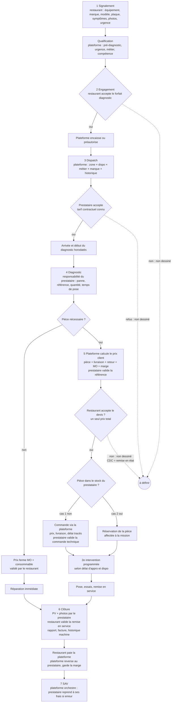

# Brief projet et PRD — appli DoctoResto (bêta avril 2027)

> Compilé le 2026-11-20 à partir du cerveau Doctoresto (sources du Drive « DOCTO RESTO » importées le même jour).
> Chaque fait renvoie à sa source. **Statut des informations** : ✅ décidé · 🟡 proposé, non voté · ❓ ouvert · 💡 proposition de compilation (à valider par l'équipe).
> **Document de référence : le process opérationnel de Lancelot** (diagramme du 2026-11-09, analysé en détail le 2026-11-21 : [[2026-11-09-process-operationnel]]). **Décision du 2026-11-21 (Florian) : en cas de conflit avec le CDC V1, le process fait foi** (forfait, chiffrage du devis, dispatch, marge, stock, paiement ; voir [[decisions]]). Il sert d'ossature au PRD (§2.3) ; le CDC V1 décrit les écrans, adaptés au process aux §2.4-2.5.
> Ce document ne remplace pas le CDC V1 de Jess ([[2026-11-02-cahier-des-charges]]) : il l'agrège avec le process, les indicateurs, les décisions et les contraintes, pour servir de base au chiffrage et au développement.

---

## Partie 1 — Brief projet

### 1.1 En une phrase
Une appli mobile de **dépannage d'urgence pour les professionnels du CHR** (restaurants, boulangeries, hôtels, traiteurs) : le client déclare sa panne en moins de 2 minutes, paie un forfait, un technicien qualifié et proche intervient ; la plateforme encaisse, reverse au technicien et **garde une marge** (process de référence, 2026-11-21). ✅ ([[business]], [[2026-11-02-cahier-des-charges]])

### 1.2 Problème
- Une panne en plein service, c'est du chiffre d'affaires perdu. Les pannes d'équipements critiques arrivent souvent tôt le matin ou le week-end. (CDC V1 ; cadrage)
- Les restaurateurs n'investissent pas dans le préventif : le besoin est **l'urgence, en one shot**. (CR du 9/11)
- Côté techniciens : environ 50 % de leur CA est payé en retard ou jamais (CR du 19/10) ; ils veulent paiement sécurisé avant intervention, plus d'affaires, interventions proches. (CR du 9/11)
- ⚠️ **Besoin pas encore vérifié côté restaurateurs** : aucun entretien documenté au 2026-11-20 (questionnaire prêt). Critère d'arrêt du cadrage : si moins de la moitié des boulangers interrogés citent une panne récente mal gérée, le besoin n'est pas assez fort. → [[validation-terrain]]

### 1.3 Marché et concurrence ([[marche-et-concurrence]], veille [[2026-11-20]])
- Pas de plateforme claire de dépannage d'urgence CHR à la demande en France : l'offre se partage entre SAV des fabricants (Electrolux Professional…), grands mainteneurs (Equans, 80 agences), distributeurs avec SAV (Pacoclean), diagnostic à distance en freelance (ComeUp).
- Logiciels FSM (gestion d'interventions, pas de mise en relation) : Praxedo, Synchroteam, InterFast, Infraspeak ; Jobber, ServiceTitan, Housecall Pro à l'international.
- Plateformes grand public : MesDépanneurs.fr (adossé à un énergéticien depuis le 2026-07-31), Yoojo, AlloVoisins.
- **Test MesDépanneurs.fr (Jessica)** : 90 € affichés pour un petit dépannage, artisan trouvé en ~3 min, SMS depuis le numéro perso du technicien 10 min après (la relation sort de la plateforme), devis par photo, intervention le lendemain, ~30 % de commission. → leçons produit : garder la communication **dans** l'appli, rapidité, prix clair.

### 1.4 Cibles (deux faces) ([[icp]])
| | Demande : client CHR | Offre : technicien |
| --- | --- | --- |
| Qui | Restaurateur, hôtelier, traiteur, boulanger | Technicien de marque (Rational, Unox, MKN, RobotCoupe…) ou artisan (électricien, plombier, maçon, peintre, bricoleur) |
| Statut | Professionnel | Auto-entrepreneur, entreprise ou partenaire. Un salarié ne peut pas facturer seul : c'est son entreprise qui contracte. |
| Attente | Rapidité, prix connu avant déplacement, pas de compte obligatoire en urgence | Paiement sécurisé avant intervention, missions proches, plus d'affaires, pièces bien tarifées |
| Cible bêta | **100 restaurateurs** (Paris) | **30 techniciens** |
| Recrutement | Terrain, Sirha, Google Ads (pistes IA) | Listes de techniciens habilités formés chaque année par les fabricants ; fabricants plus favorables que les installateurs (>50 % des installateurs réticents, 2-3 déjà fans) |

Personas des maquettes v6 : **Marie** (Boulangerie Martin) côté client ; **Karim** (DoctoResto Pro) côté technicien. ([[2026-11-02-maquette-ecrans-v6]])

### 1.5 Objectifs et jalons ([[business]], CR du 9/11, diapos du 2/11)
| Date | Jalon |
| --- | --- |
| 21-25 janv. 2027 | Sirha Lyon : négociation fabricants, **au moins un visuel côté technicien** à montrer |
| Janv.-avril 2027 | Référencer fabricants, pièces, puis techniciens habilités |
| Avant avril 2027 | Création de WRLJ SAS (porte le risque d'incident) |
| **Avril 2027** | **Bêta à Paris** (100 clients visés) — cliff du vesting des associés |
| Avril-déc. 2027 | 500 clients |
| 2028 | Développement national, 5 000 clients fin 2028 |

### 1.6 Modèle économique ([[offer]])
- ✅ **Forfait de diagnostic** payé (ou préautorisé) à l'engagement, prix connu avant le déplacement. Montant de référence : **129 € HT**, donné « à titre d'exemple » dans le process, à confirmer. Il couvre le déplacement et le diagnostic, **pas de temps de réparation inclus**. (process de référence, décision du 2026-11-21 ; remplace le forfait de 110 € avec 45 min du CDC)
- ✅ Après le diagnostic, deux cas : **sans pièce**, prix ferme (MO + consommable éventuel) validé par le restaurant, réparation immédiate ; **avec pièce**, devis complémentaire calculé par la plateforme (pièce + livraison + retour + MO + marge), **un seul prix total**, aucune commande sans accord.
- ✅ **Revenu = marge** : le prestataire travaille à un **tarif contractuel plateforme** connu d'avance ; le client paie le prix calculé par la plateforme ; la différence reste à la plateforme. Seuil de marge brute de Lancelot : > 25 % (alerte < 15 %). (décision du 2026-11-21 ; remplace la commission de 10 % du prévisionnel)
- ❓ Montants à fixer : grille des tarifs contractuels, taux de MO, règle de marge (par pièce, par intervention ?). Le **prévisionnel de Jess est à refaire** sur ce modèle.
- Hors bêta : paiement en 3 fois (gros devis), abonnements.

### 1.7 Équipe et ressources
| Qui | Rôle sur l'appli |
| --- | --- |
| Florian (10 %) | **Responsable développement** ; maquette v6 ; doit chiffrer temps et coût de la bêta |
| Jessica (37,5 %, présidente) | CDC V1 (machines), pannes/pièces, fabricants, prévisionnel |
| Lancelot (37,5 %) | Process opérationnel, indicateurs, questionnaire, CDC artisans |
| Léa (15 %) | Com, nom/INPI, coûts géoloc, pistes de style, premier prototype fait avec Claude |

**Contrainte majeure** : disponibilité de Florian = 3 h/semaine pendant 3 semaines puis ~1 h/jour, **peu disponible en mars et avril 2027**, juste avant la bêta. (CR du 26/10) → le développement doit être quasi terminé fin février 2027. 💡

Budget dev dans le prévisionnel 2027 : **3 500 € (dev mobile et cloud)**. Toute dépense > 5 000 € requiert 3 voix sur 4 (pacte, art. 6). La propriété intellectuelle (code, maquettes, bases) est cédée à la société (art. 1).

---

## Partie 2 — PRD (Product Requirements Document)

### 2.1 Périmètre de la bêta
**Dans la bêta** ✅
- Zone : **tout Paris**. (CR du 26/10)
- Interventions les plus demandées, **3 marques au début**. (CR du 26/10) ❓ Les 3 marques ne sont pas encore choisies ; seul Rational est documenté.
- 6 familles d'équipements (CDC) : four et sauteuse · lave-verre et lave-vaisselle · café · fourneau et friteuse · frigo · robot. Marques listées : Rational, Unox, Hobart, MKN, Convotherm (+ « autre marque » à valider).
- Second parcours simplifié « autre équipement » pour les artisans.
- Apps **iOS et Android**, parcours client et technicien, paiement, notifications, **back-office** (validation EXPERT, suivi, litiges). (CDC, MVP)
- Facture automatique par mail. (CDC)

**Hors bêta** ✅
- Suivi du technicien en temps réel (coût API Google) — mais le technicien doit être **dans le périmètre** géographique. (CR du 9/11)
- Machines connectées (codes d'erreur), paiement en 3 fois, abonnements (phase 2 du CDC).
- Affectation **entièrement automatique** (en bêta : la plateforme choisit, avec un outil d'aide), diagnostic par IA, GPS intégré (Waze suffit). (cadrage)
- ⚠️ Le **stock du prestataire** entre dans la bêta (process de référence, 2026-11-21), alors que le cadrage le repoussait : contrôle et réservation de la pièce par mission.

**Écarts à trancher** ❓
- Cadrage (13/10) : cible boulangerie (four, pétrin, diviseuse, froid ; marques Bongard, Pavailler, Panimatic, VMI) et **mode hors-ligne** (labos mal couverts). Le CDC (2/11) a élargi à la cuisine pro et ne mentionne plus le hors-ligne.
- Cadrage / ODJ du 26/10 (point 14) : **déclarer une panne sans créer de compte**. Le CDC place une étape de connexion avant la déclaration.

### 2.2 Rôles
| Rôle | Description |
| --- | --- |
| Client | Professionnel CHR qui déclare une panne et paie |
| Technicien de marque | Habilité sur une ou plusieurs marques |
| Artisan | Électricien, plombier, maçon, peintre, bricoleur |
| EXPERT DoctoResto (back-office) | Valide les candidatures techniciens, suit les missions, traite les litiges |
| 💡 Admin | Gère catalogues (familles, marques, pannes, pièces, prix), tarifs, paramètres |

### 2.3 Process opérationnel de référence (Lancelot) — ossature du produit
Source : [[2026-11-09-process-operationnel]] (diagramme en 3 couloirs, transcription complète et analyse dans la fiche). Principe : **la plateforme porte la relation commerciale, le prestataire la responsabilité technique.** C'est le document le plus structurant pour le dev : chaque case devient un écran, une action back-office, un statut ou une règle.

**Flux (réécrit en Mermaid pour le dev)**

**Statuts d'une intervention (💡 déduits du process de référence)**
`signalée` → `qualifiée` → `forfait accepté / payé` → `proposée au prestataire` → `acceptée` → `prestataire sur place` (horodaté) → `diagnostiquée` → soit `réparation immédiate validée` → `réparée`, soit `devis envoyé` → `devis accepté` (ou `devis refusé` → remise en état) → `pièce réservée` ou `pièce commandée` → `2e passage planifié` → `réparée` → `remise en service validée` → `payée` → `prestataire réglé` → `close` ; branche `réclamation SAV` ouverte après clôture.

**Qui fait quoi, et ce que ça demande à l'appli**
| Étape | Restaurant (appli client) | Plateforme (back-office) | Prestataire (appli pro) |
| --- | --- | --- | --- |
| 1 Signalement | Formulaire : équipement, marque, **modèle, plaque (photo)**, symptômes, photos, urgence | File des demandes ; pré-diagnostic et choix du métier et de la compétence (manuel en bêta) | — |
| 2 Engagement | Accepte et paie le forfait diagnostic | Encaissement ou préautorisation (prix connu avant déplacement) | — |
| 3 Dispatch | — | Choix du prestataire sur 5 critères (manuel assisté en bêta : liste filtrée et triée) | Reçoit la mission avec le **tarif contractuel**, accepte |
| 4 Diagnostic | Accueille le technicien | Suit la mission ; horodatage arrivée / début | Diagnostic ; saisit panne, **référence, quantité, temps de pose** |
| Sans pièce | Valide le prix ferme sur place | Calcule le prix ferme (MO + consommable) | Répare tout de suite |
| 5 Appro | Reçoit **un seul prix total** et accepte | Calcule le prix client ; enregistre l'accord ; **aucune commande sans accord** | Valide la référence (erreur à sa charge) ; déclare son stock |
| Stock | — | Réserve la pièce ou la commande (prix fournisseur, livraison, délai tracés) | Confirme la disponibilité réelle ; la pièce réservée est bloquée pour les autres missions |
| 2e passage | Reçoit la date | Programme selon délai d'appro et disponibilité | Pose, essais, remise en service |
| 6 Clôture | Valide la remise en service ; paie | Rapport, facture, **historique machine** ; encaisse puis reverse | PV technique : pièce posée, tests, temps passé, photos |
| 7 SAV | Réclame auprès de la plateforme, son seul interlocuteur | Orchestre la réclamation ; pas de nouvelle facture si erreur du prestataire | Reprend à ses frais (diagnostic, référence, malfaçon) |

**Conséquences pour le périmètre de la bêta** 💡
- Le **back-office est central** (qualification, dispatch, calcul de prix, commandes, planification, SAV) : en bêta, l'équipe fait ces gestes à la main dans un outil interne simple ; l'automatisation (dispatch, prix) vient après.
- Il faut des **référentiels avant le lancement** : grille de tarifs contractuels des prestataires, taux de MO, consommables, catalogue pièces avec prix fournisseur, frais de livraison et de retour, règle de marge. Base existante : Rational ([[2026-11-01-pannes-rational]]).
- **Plusieurs passages par intervention** et **stock du prestataire** sont dans la bêta (décision du 2026-11-21). 💡 Version minimale proposée : à chaque devis, le prestataire confirme « pièce dans mon camion : oui/non » et la plateforme la réserve pour la mission, sans inventaire complet.
- **Paiement** (décision du 2026-11-21) : forfait encaissé ou préautorisé à l'engagement ; **le reste est payé à la clôture**, après validation de la remise en service ; la plateforme reverse ensuite au prestataire. ⚠️ Une préautorisation carte expire (environ 7 jours chez Stripe) : avec un délai d'appro, prévoir d'enregistrer la carte (paiement différé) et de débiter à la clôture.

### 2.4 Parcours client — 14 écrans (CDC V1)
| # | Écran | Exigences |
| --- | --- | --- |
| C1 | Accueil | 2 boutons : « J'ai une panne » / « Je suis un technicien » |
| C2 | Connexion | Identifiants, Face ID, Apple, Google, saisie manuelle. ❓ Parcours sans compte en urgence |
| C3 | Type | Machine en panne ou autre équipement (parcours artisan simplifié) |
| C4 | Famille | 6 familles d'équipements |
| C5 | Marque | Rational, Unox, Hobart, MKN, Convotherm ; « autre marque » à valider |
| C6 | Connectée ? | Machine connectée ou non (info seulement en bêta) |
| C7 | Description | Texte + photo. 💡 Ajouter modèle et photo de la plaque signalétique (process étape 1) |
| C8 | Récapitulatif et géolocalisation | Consentement RGPD |
| C9 | Conditions du forfait | **Forfait de diagnostic** (réf. 129 € HT) ; ensuite prix ferme sans pièce, ou devis complémentaire avec pièce ; paiement du reste à la clôture *(adapté au process ; le CDC disait 110 € avec 45 min)* |
| C10 | Paiement | Forfait encaissé ou préautorisé ; carte enregistrée pour le reste ; CB, Apple Pay, 3-D Secure ; (3 fois : hors bêta). Cible : panne → commande **< 2 min** |
| C11 | Prestataire et heure d'arrivée | Prestataire choisi par la plateforme ; heure confirmée par lui (pas de suivi en direct en bêta) |
| C12 | Prix ou devis | Sans pièce : valider le prix ferme sur place. Avec pièce : devis calculé par la plateforme, **un seul total**, accepter ou refuser (refus = remise en état initial, CDC) ; si pièce à commander, date du 2e passage |
| C13 | Remise en service | Le restaurant **valide la remise en service** (sinon : réclamation) ; puis paiement du reste, rapport et facture |
| C14 | Notation | Ponctualité, professionnalisme, explications, appli, recommandation |

Écrans complémentaires vus dans la maquette v6 : historique des interventions, factures, compte. ([[2026-11-02-maquette-ecrans-v6]])

### 2.5 Parcours technicien — 11 écrans (CDC V1)
| # | Écran | Exigences |
| --- | --- | --- |
| T1 | Accueil | — |
| T2 | Connexion et géolocalisation | — |
| T3 | Profil | Artisan (métier) ou technicien de marque (marques) |
| T4 | Candidature | Validée par un EXPERT en back-office. Pièces à exiger (piste IA) : Kbis, attestation URSSAF, RC pro et décennale, habilitations (électrique, fluides frigorigènes). 💡 + données DAC7 (identité, SIREN, IBAN) |
| T5 | Mission proposée | Proposée par la plateforme (meilleur prestataire), avec le **tarif contractuel** ; accepter et fixer son heure ; refus → la plateforme propose au suivant |
| T6 | Détail de la panne | Infos et photos du client |
| T7 | Arrivée | Validée par géolocalisation ; **horodatage arrivée / début du diagnostic** *(plus de compteur de 45 min)* |
| T8 | Diagnostic | Panne, **référence, quantité, temps de pose** ; pièce nécessaire oui/non ; réparation impossible |
| T9 | Prix / devis | Sans pièce : prix ferme calculé par la plateforme, réparation immédiate. Avec pièce : **la plateforme calcule le prix client** ; le prestataire **valide la référence** (erreur à sa charge) et indique si la pièce est dans son stock (réservée) ou à commander (il valide la commande technique) |
| T10 | Réponse client et 2e passage | Refus = remise en état initial ; accord → pose immédiate si pièce dans le camion, sinon 2e passage planifié |
| T11 | Clôture | **PV technique** : pièce posée, tests, temps passé, photos avant/après ; paiement par la plateforme |

Maquette v6 côté technicien : statut disponible / hors ligne, missions à moins de 20 km, planning, revenus. Photo de la pièce obligatoire au diagnostic.

### 2.6 Back-office (CDC : validation EXPERT, suivi, litiges ; process : §2.3)
Fonctions issues du CDC et du process de Lancelot :
1. **Candidatures prestataires** : validation EXPERT, pièces justificatives, métiers, marques habilitées, zone, **tarif contractuel**.
2. **File des demandes et qualification** : pré-diagnostic, urgence, métier, compétence.
3. **Dispatch** : liste des prestataires filtrée (zone, disponibilité, métier, marque) et triée (historique) ; envoi de la mission ; relance si refus ou absence de réponse.
4. **Suivi en direct des missions** par statut (§2.3), avec horodatages.
5. **Calcul de prix** : prix ferme sans pièce (MO + consommable) ; prix client avec pièce (pièce + livraison + retour + MO + marge) ; un seul total affiché au client.
6. **Pièces** : catalogue par marque, prix fournisseur, poids ; réservation sur le stock du prestataire ou commande fournisseur (prix, livraison, délai tracés).
7. **Planification** des 2es passages.
8. **Clôture** : contrôle du PV et des photos, rapport, facture, historique machine.
9. **Paiements** : encaissements, reversements aux prestataires, marge ; export comptable ; données DAC7.
10. **SAV et litiges** : réclamations, imputation au prestataire (reprise à ses frais), suivi.
11. **Indicateurs** (§2.10) et catalogues (familles, marques, pannes, pièces).

### 2.7 Règles métier
| Règle | Statut |
| --- | --- |
| Forfait de diagnostic (réf. 129 € HT) payé ou préautorisé à l'engagement, prix connu avant déplacement | ✅ process (2026-11-21) |
| Arrivée et début du diagnostic horodatés (plus de compteur de 45 min) | ✅ process (2026-11-21) |
| Reste à payer réglé à la clôture, après validation de la remise en service | ✅ process (2026-11-21) |
| Refus du devis : machine remise en l'état initial | ✅ CDC |
| La plateforme choisit le prestataire (zone × dispo × métier × marque × historique) ; refus → proposé au suivant | ✅ process (2026-11-21) + CDC |
| Le technicien doit être dans le périmètre (pas de suivi en direct) | ✅ CR 9/11 |
| Paiement en 3 fois : gros devis seulement, hors bêta | ✅ |
| Responsabilité commerciale = plateforme ; technique = prestataire | ✅ process |
| Forfait remboursé si aucun technicien trouvé | 🟡 maquette v6 |
| Remboursement du forfait si panne non réparable | ❓ |
| Délai maximum si aucun technicien disponible | ❓ |
| Machine non listée / « autre marque » | ❓ |
| Revenu = marge ; prestataire payé à son tarif contractuel | ✅ process (2026-11-21) ; montants ❓ |
| Astreinte payée ou non (5 h du matin, dimanche) | ❓ cadrage |
| Marge intégrée au prix des pièces (pièce + livraison + retour + MO + marge) | ✅ process (2026-11-21) |
| Prise en compte des affinités client-technicien existantes dans le dispatch | 💡 indicateurs de Lancelot |
| Le prestataire engage sa responsabilité sur son diagnostic et sur la référence de pièce | ✅ process |
| Prix client calculé par la plateforme ; un seul prix total visible | ✅ process (2026-11-21) |
| Réparation sans pièce : prix ferme MO + consommable validé par le restaurant | ✅ process (2026-11-21) |
| Aucune commande de pièce sans accord du client | ✅ process |
| Pièce réservée = indisponible pour toute autre mission | ✅ process (2026-11-21) |
| 2e intervention planifiée selon délai d'appro et disponibilité | ✅ process (2026-11-21) |
| Clôture : PV + photos du prestataire, validation du restaurant | ✅ process (2026-11-21) |
| SAV : pas de nouvelle facture si erreur du prestataire, reprise à sa charge | ✅ process |
| Durée de la garantie, délai de paiement du prestataire | ❓ |

### 2.8 Cas limites à prévoir ([[2026-11-09-indicateurs-suivi]])
45 min de circulation · parking impossible · technicien mobilisé 1 h 45 · modèle non identifié · appareil inaccessible · client incapable d'expliquer la panne · référence illisible · panne intermittente · machine à remplacer · peur de la concurrence entre prestataires · aucun technicien disponible · panne non réparable · litige.

### 2.9 Exigences non fonctionnelles
- **Plateformes** : iOS et Android (CDC). Publication App Store et Play Store (coûts listés au prévisionnel).
- **Performance d'usage** : de la panne à la commande en moins de 2 minutes (CDC).
- **Réseau** : labos et cuisines souvent mal couverts → mode dégradé / hors-ligne au moins côté technicien. ❓ (cadrage, absent du CDC)
- **Paiement** : CB, Apple Pay, 3-D Secure ; pré-autorisation ou encaissement du forfait (process) ; reversement aux techniciens → **marketplace avec paiements fractionnés** (piste : Stripe Connect). Frais Stripe estimés à ~3,85 € par intervention de 240 € (doc IA, à vérifier).
- **Conformité** :
  - **RGPD** : géolocalisation et photos (consentement, durée de conservation ❓).
  - **DAC7** : déclaration annuelle à la DGFiP des revenus versés aux techniciens ; KYC et diligences sur les vendeurs (veille du 2026-11-20).
  - CGU plateforme, statut et RC pro des artisans, habilitations électriques et fluides frigorigènes.
  - Facturation automatique conforme.
- **Coûts d'exploitation** : 0,20 à 1 € par utilisateur et par mois (estimation de Florian, 13/10). Temps réel Firebase/Supabase : 0-25 €/mois au début. Google Routes/géocodage : 10 000 appels gratuits/mois puis 5 $ les 1 000 ; à 500 interventions/mois, un recalcul toutes les 2 min reste gratuit, toutes les 30 s ≈ 50 $ ([[2026-11-09-cout-geolocalisation]]).
- **Propriété intellectuelle** : code et maquettes cédés à WRLJ (pacte, art. 1) ; e-Soleau (CDC, maquettes, concept) avant le Sirha.

### 2.10 Indicateurs produit ([[2026-11-09-indicateurs-suivi]], CDC)
| Indicateur | Continuer | Alerte |
| --- | --- | --- |
| Acceptation des devis | > 70 % | < 50 % |
| Prestataire trouvé | > 95 % | < 85 % |
| Intervention urgente en < 4 h | > 80 % | < 60 % |
| Résolution au premier passage | > 65 % | < 45 % |
| Litiges | < 5 % | > 10 % |
| Marge brute par intervention | > 25 % | < 15 % |
| Restaurants qui réutilisent le service | > 40 % | < 20 % |
| Erreur de diagnostic ou de référence | < 5 % | > 10 % |
CDC : délai d'arrivée, réparation au premier passage, note moyenne. Doc IA : note > 4,7, coût d'acquisition < 25 €. Fréquence visée : 1,5 intervention par mois et par client (2027).
💡 Chaque indicateur implique un événement à tracer dans les données (horodatages de demande, acceptation, arrivée, clôture ; issue ; litige ; prix pièce et marge).

### 2.11 Modèle de données (ébauche 💡)
- **Utilisateur** (client | technicien | expert | admin), auth (Apple, Google, Face ID, email).
- **Établissement client** : nom, type CHR, adresse/coordonnées, contacts.
- **Technicien** : statut (artisan | marque), métiers, marques habilitées, zone, disponibilité, documents (Kbis, URSSAF, RC pro, décennale, habilitations), données DAC7 (identité, SIREN, IBAN), statut de validation, note.
- **Équipement** : famille, marque, modèle, plaque, connecté (oui/non), historique d'interventions.
- **Catalogue** : familles → marques → pannes fréquentes (codes erreur) → pièces (référence, prix moyen HT, poids). Données initiales : [[2026-11-01-pannes-rational]] (fours mixtes : 9 pièces, de 12 € à 810 € HT ; sauteuses iVario : 12 pièces).
- **Intervention** : demande (symptômes, photos, urgence, modèle, plaque), qualification (métier, compétence), statut (§2.3), prestataire, heures (demande, acceptation, arrivée prévue, arrivée réelle, début du diagnostic, fin), diagnostic (panne, référence, quantité, temps de pose), issue, rapport.
- **Passage** : une intervention peut avoir plusieurs passages (diagnostic, pose) ; date planifiée, horodatages, PV (pièce posée, tests, temps passé, photos).
- **Tarif contractuel prestataire** : taux de MO, forfaits, consommables.
- **Stock prestataire** (minimal) : pièce, quantité, réservation liée à une intervention.
- **Commande fournisseur** : fournisseur, référence, prix fournisseur, frais de livraison et de retour, délai, statut.
- **Réclamation SAV** : intervention liée, motif (diagnostic, référence, malfaçon), imputation, résolution.
- **Devis** : type (réparation immédiate sans pièce / complémentaire avec pièce), lignes internes (MO, consommable, pièce, livraison, retour, marge) et **un seul total affiché au client**, statut, accord horodaté, paiement associé.
- **Paiement / reversement / facture**, **litige**, **notation** (5 critères).

### 2.12 Options techniques et chiffrage (à produire par Florian)
Pistes du doc IA de la feuille de route (non relu par l'équipe, [[2026-11-15-feuille-de-route-ia]]) :
| Option | Délai | Coût |
| --- | --- | --- |
| No-code : Bubble ou Sharetribe + Stripe Connect (recommandé par le doc) | 3 à 6 semaines | 0 à 3 500 € |
| Sur mesure : React/Node | 3 à 6 mois | 15 000 à 35 000 € (prestataire) |
Autres repères : géoloc en direct en freelance 1 500 à 5 000 € (hors bêta) ; budget de lancement 6 mois 5 000 à 9 000 € (doc IA) ; dev mobile et cloud 3 500 € au prévisionnel 2027.
💡 Critères de choix à documenter dans le chiffrage : apps natives iOS/Android exigées par le CDC (Sharetribe est surtout web), hors-ligne, Stripe Connect et KYC/DAC7, back-office, réversibilité du code (cédé à la société), dev assisté par IA (Léa a déjà un prototype Claude), disponibilité réduite de Florian en mars-avril 2027, coûts récurrents.
Actions liées : envoyer ses estimations de coûts à Jess (prévisionnel) ; relever les heures de dev (valorisation au bilan, apport de Florian en partie en travail).

### 2.13 Identité visuelle
- 6 pistes de style ([[2026-11-02-pistes-style]]) ; **le bleu plaît à la majorité** (CR du 9/11), probablement la piste F « Gyrophare » : bleu nuit #0A1F44, ambre #FFB000, acier ; Plus Jakarta Sans ; « urgence maîtrisée, confiance ».
- Contrainte : **éviter le bleu cyan et toute typo proche de Doctolib** (risque de parasitisme). L'orange/beige de la première maquette de Léa fait « appli générée par IA ».
- Maquette v6 (Florian) : design system forêt, orange, lime, blé ; thèmes clair et sombre — antérieure au choix du bleu.
- Nom : plutôt **DoctoResto** pour l'appli, pas définitif ; société WRLJ. Vérifier domaine et @doctoresto. ([[2026-11-09-recap-nom-inpi]])

### 2.14 Planning de développement (💡 proposition à valider)
| Période | Livrable |
| --- | --- |
| Fin nov. 2026 | Chiffrage temps/coût + choix no-code ou sur mesure ; réponses aux questions ouvertes du CDC |
| Déc. 2026 | Visuels côté technicien (pour le Sirha) ; choix de la piste graphique ; e-Soleau |
| Janv. 2027 | Sirha (21-25/01) : démo côté technicien ; catalogue pièces/marques complété avec les fabricants |
| Janv.-fév. 2027 | Développement MVP, back-office, paiement, onboarding techniciens |
| Mars 2027 | Tests avec quelques techniciens et restaurateurs (Florian peu disponible : prévoir le relais) |
| Avril 2027 | Bêta Paris |

---

## Partie 3 — Incohérences et questions ouvertes

### 3.1 Incohérences entre sources
| Sujet | Valeurs | Sources |
| --- | --- | --- |
| Forfait | 80 € (déplacement + 1re heure) · 110 € (45 min) · **129 € HT, forfait de diagnostic (référence depuis le 2026-11-21, montant à confirmer)** · panier 240 € | maquette v6 · CDC + CR 9/11 · process · doc IA |
| Commission | 20-30 % · 10-15 % · 10 % · 12 % → **tranché le 2026-11-21 : marge, pas commission** (prévisionnel à refaire) | cadrage · CR 19/10 · prévisionnel · doc IA |
| Cible | Boulangerie (four, pétrin, diviseuse, froid) · cuisine pro (6 familles) | cadrage · CDC |
| Compte obligatoire | Déclarer sans compte · connexion en écran 2 | ODJ 26/10 · CDC |
| Suivi en direct | Oui (« arrivée dans 24 min ») · non en bêta | maquette v6 · CR 9/11 |
| Prévisionnel | CA trimestriel = un seul mois ; clients fin 2027 : 1 500 (sheet) vs 500 (diapos) ; 2 250 interventions/mois au T4 avec ~30 techniciens ≈ 75 par technicien | [[2026-11-09-previsionnel-financier]] |
| Classes INPI | 9/37/42 · 35/37/42 | récap Léa · doc IA |

**Tranché le 2026-11-21 : le process de Lancelot fait foi** ([[decisions]])
| Sujet | Retenu (process) | Écarté |
| --- | --- | --- |
| Contenu du forfait | Diagnostic seul ; réparation sans pièce facturée en prix ferme | 45 min de dépannage incluses (CDC) |
| Qui chiffre le devis | La plateforme ; le prestataire valide la référence | Le technicien saisit durée + pièce (CDC) |
| Affectation | La plateforme choisit le meilleur prestataire | Alerte ouverte (CDC) ; manuelle pure (cadrage) |
| Revenu | Marge sur tarif contractuel | Commission de 10 % (prévisionnel) |
| Stock du prestataire | Contrôlé et réservé par mission, dès la bêta | « Plus tard » (cadrage) |
| Paiement du complément | À la clôture | À l'acceptation du devis (CDC) |

### 3.2 Questions à trancher avant / pendant le développement
1. Montants : forfait de diagnostic (129 € HT à confirmer), grille des tarifs contractuels, taux de MO, règle de marge.
2. Remboursement du forfait si panne non réparable ; si aucun technicien trouvé ; délai maximum.
3. Les 3 marques et les interventions de la bêta (Jess et Lancelot) ; liste des pannes artisans (Lancelot).
4. Parcours sans compte pour une urgence ?
5. Mode hors-ligne dans la bêta ?
6. Gestion de « autre marque » / machine non listée.
7. Litiges : qui arbitre, quel délai, quelles preuves (photos, géoloc) ?
8. Astreinte de nuit / week-end : majoration ?
9. Durée de conservation des données de géolocalisation et des photos (RGPD).
10. Statut, assurances et pièces justificatives exigées des techniciens ; contrat technicien.
11. No-code ou sur mesure (chiffrage de Florian).
12. Nom définitif et charte graphique.
13. Stock du prestataire (retenu dans la bêta) : simple « oui/non » par mission ou inventaire ?
14. Fournisseurs de pièces de la bêta et mode de commande (manuel par l'équipe ou intégré).
15. Branches absentes du process : refus du forfait, refus de mission, refus du devis, panne non réparable, remise en service non validée.
16. Durée de garantie et mécanisme d'imputation au prestataire (retenue sur reversement ?).
17. Présenter à l'équipe l'alignement sur le process (le CDC de Jess et le prévisionnel sont à mettre à jour).

### 3.3 Risques
- **Besoin non validé** côté restaurateurs (aucun entretien documenté).
- **Contournement** : le client rappelle le technicien en direct ; accepté à petite échelle (CR 9/11) ; leviers : rapidité, géolocalisation, paiement sécurisé, communication dans l'appli.
- **Offre de techniciens** : réticence des installateurs ; dépendance aux listes des fabricants.
- **Responsabilité** en cas d'incident (d'où la société créée avant la bêta) ; assurances.
- **Marque** : opposition possible de Doctolib.
- **Capacité de dev** : faible disponibilité de Florian juste avant la bêta.
- **Réglementaire** : DAC7, CGU, KYC techniciens.

---

## Sources
Contexte : [[business]], [[icp]], [[offer]], [[me]] · Projets : [[app-beta]], [[validation-terrain]], [[sirha-2027]], [[creation-societe]] · Décisions : [[decisions]] · Sources Drive : [[2026-10-13-cadrage-doctoresto]], [[2026-10-19-cr-reunion]], [[2026-10-22-questionnaire-restaurateurs]], [[2026-10-26-cr-reunion]], [[2026-10-26-odj-reunion]], [[2026-11-01-pannes-rational]], [[2026-11-02-cahier-des-charges]], [[2026-11-02-maquette-ecrans-v6]], [[2026-11-02-pistes-style]], [[2026-11-02-pacte-associes]], [[2026-11-09-cr-reunion]], [[2026-11-09-process-operationnel]], [[2026-11-09-indicateurs-suivi]], [[2026-11-09-cout-geolocalisation]], [[2026-11-09-previsionnel-financier]], [[2026-11-09-recap-nom-inpi]], [[2026-11-15-feuille-de-route-ia]] · Marché : [[marche-et-concurrence]], veille [[2026-11-20]].
